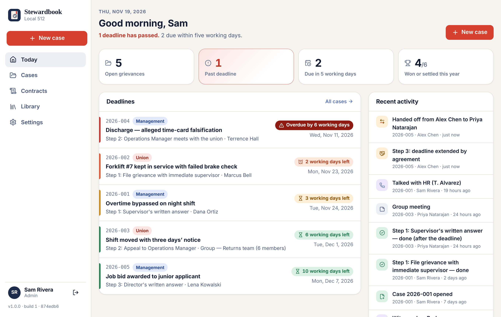
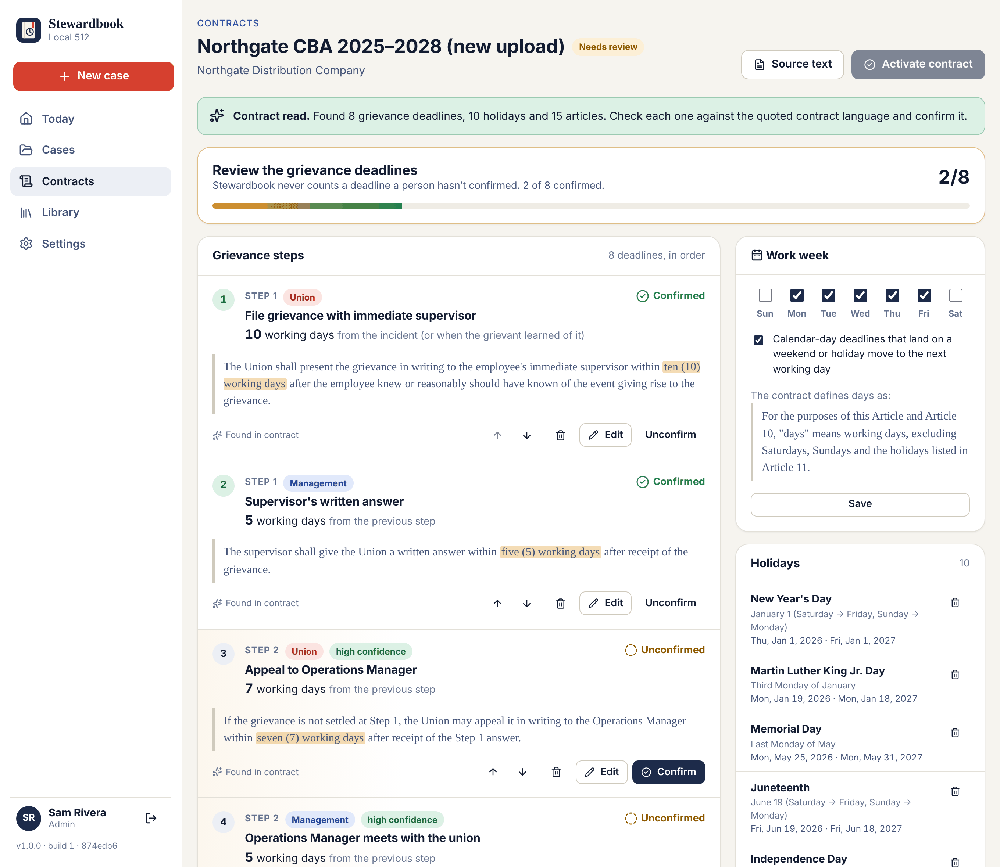
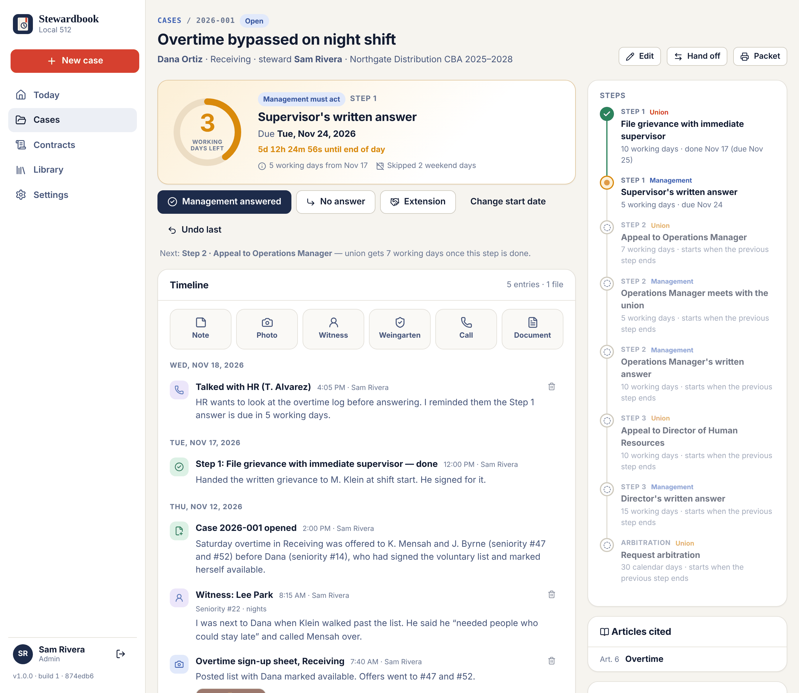
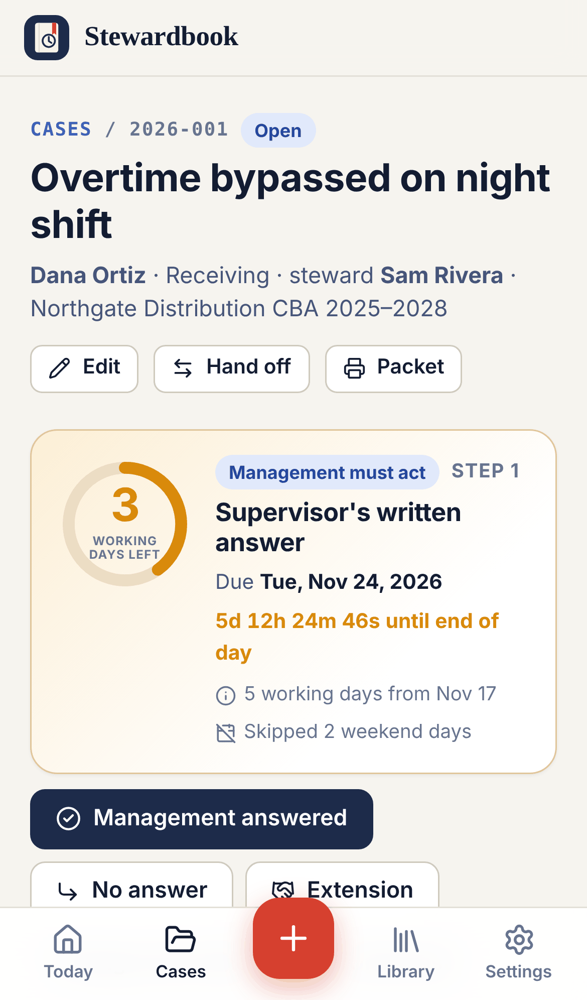
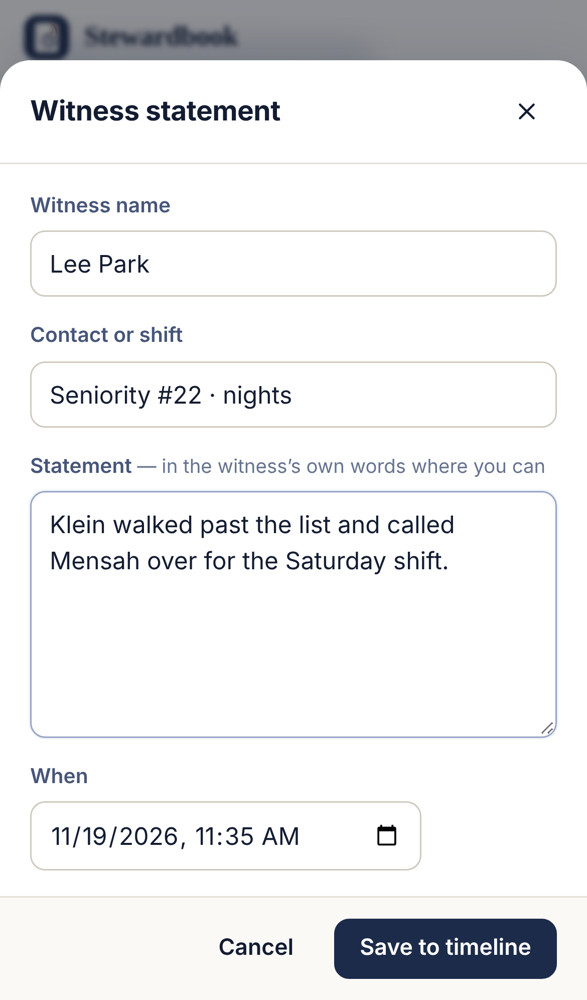
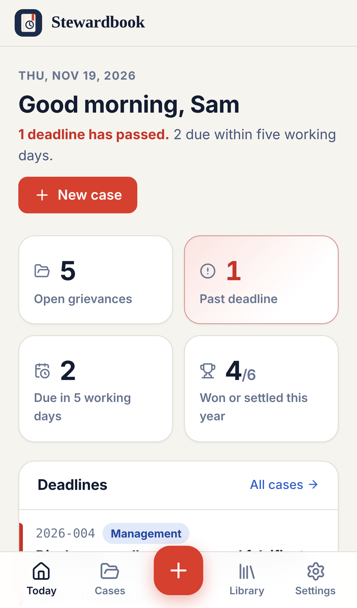
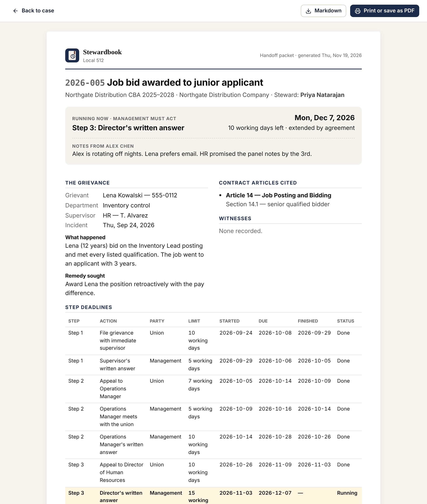
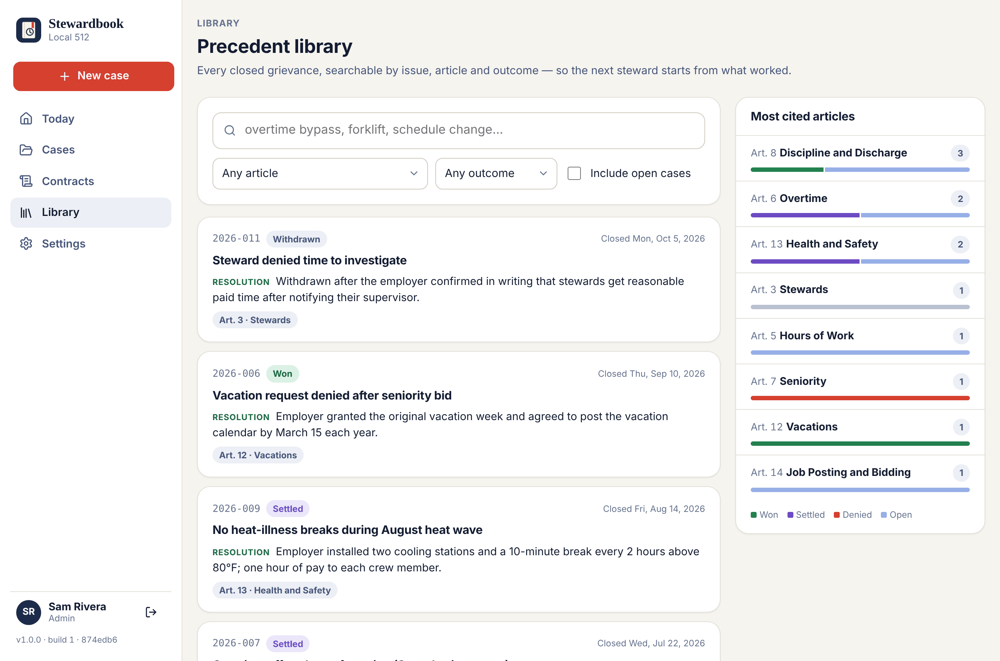
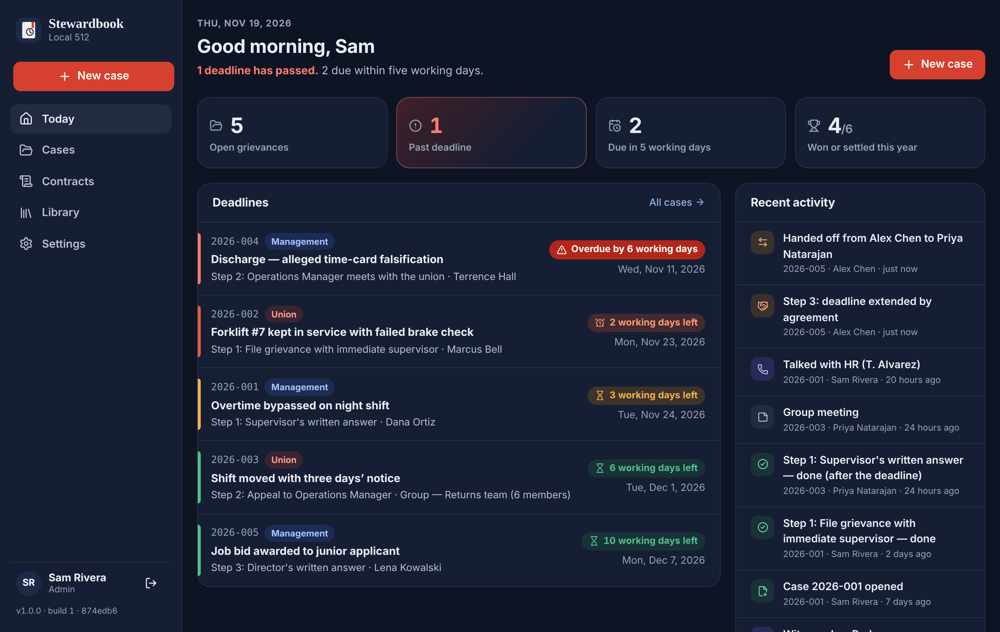
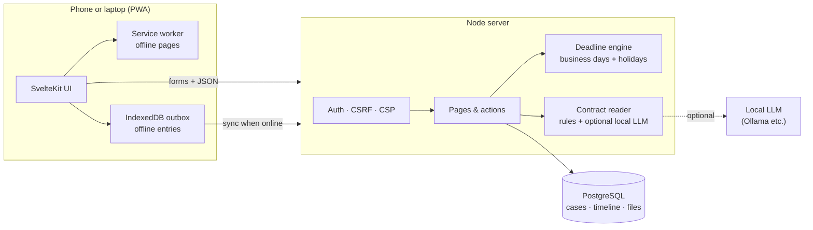

<div align="center">


# Stewardbook

**The grievance tracker for union stewards.**<br />
Paste your contract once. Every case gets a countdown clock that knows your step deadlines, your work week and your contract holidays.

[](https://github.com/lobojoel2003/Stewardbook/actions/workflows/ci.yml)
[](https://github.com/lobojoel2003/Stewardbook/actions/workflows/codeql.yml)
[](https://github.com/lobojoel2003/Stewardbook/releases)
[](https://github.com/lobojoel2003/Stewardbook/pkgs/container/stewardbook)
[](LICENSE)

[Features](#features) · [Quick start](#quick-start) · [How deadlines are counted](docs/DEADLINES.md) · [Deploy](docs/DEPLOYMENT.md) · [Releases](#versions-builds-and-releases)



</div>

## Why

Shop stewards are rank-and-file workers who handle grievances for their coworkers. Every union contract sets hard step
deadlines — say, 10 working days to file and 5 for management to answer — and **a missed deadline can forfeit the
grievance**. In small locals those deadlines live in notebooks, email threads and spreadsheets, and the case history
leaves with the steward when they rotate out.

The commercial tools are built for the union office, priced by quote, and hard to justify for a small local. The
open-source ones are one-offs written for a single branch. Stewardbook is a free, self-hosted tool for the person on
the shop floor:

- it reads **your** contract, so the deadlines are yours, not a template;
- it counts **working days** the way your contract does, skipping weekends and **contract holidays**;
- it works on a phone with bad signal, and keeps **the whole case file with the local**, not the steward.

## Features

### Your contract, read once

Paste the agreement or upload the PDF. Stewardbook finds the grievance procedure, pulls out every step and its day
count, reads the holiday list and indexes every article. Each deadline is shown next to the exact contract sentence it
came from, highlighted — and **nothing is used until a person confirms it**.



- Understands "ten (10) working days", "fifteen days", "STEP ONE:", "Section 9.3 Step 1.", passive voice, roman-numeral articles and "days means working days" definitions.
- Recognizes 20+ common contract holidays (Thanksgiving and the day after, Juneteenth, Good Friday, Election Day…) and the contract's own weekend-observance rule.
- Lists the time limits it deliberately skipped (e.g. the arbitrator's deadline) so nothing disappears silently.
- Optional: a **local** AI model (Ollama, llama.cpp, LM Studio — anything OpenAI-compatible) can draft the steps instead. The contract never leaves your server, every quote is checked against the text, and a person still confirms each step.
- "Try the timeline" shows the latest possible date for every step from any start date.

### A countdown clock on every case



- Counts **working days left**, with a live clock to the end of the due date, colour-coded from green to overdue.
- Says what it skipped: _"Skipped Thanksgiving Day, Day after Thanksgiving and 4 weekend days."_
- One tap to record that a step was done, that **management didn't answer** (the next clock starts from the missed date), a **mutually agreed extension**, or a skipped step (discharges filed straight to Step 2).
- Late filings and late answers are flagged in the step tracker — useful at arbitration.

### One tap from the shop floor — even offline

<p>



</p>

- **Note, photo, witness statement, Weingarten meeting notes, call log, document** — each is one tap.
- Photos are shrunk on the phone before upload; files are stored in Postgres so one backup holds the whole case file.
- Installable **PWA**. Cases you've opened stay readable offline, and anything you add without signal is kept on the device and **syncs automatically** when you're back online — with no duplicates.

### Clean handoffs

When a steward rotates out, **Hand off** reassigns the case with notes for the next person and produces a **handoff
packet**: where it stands, the running deadline, witnesses, articles cited, every step date and the full timeline.
Print it, save it as PDF, or download it as Markdown. Any case can also be exported as JSON.



### A precedent library that builds itself

Every case cites the contract articles it relies on. Close a case with its outcome and resolution and it becomes
searchable for every steward: _"overtime bypass"_, _"Article 6"_, _"settled"_. Each article shows how often it has
been cited and how those grievances ended.



### And the rest

- **Calendar feed**: subscribe your phone's calendar to your running deadlines (with reminders).
- **Team**: admins add stewards, reset passwords and deactivate accounts — cases always stay with the local.
- **Dark mode**, keyboard-friendly, and accessible labels throughout.
- **Security**: scrypt password hashes, hashed session tokens, login throttling, CSRF protection, a strict Content-Security-Policy and private, non-guessable calendar links.



## Quick start

### Docker (recommended)

```bash
curl -O https://raw.githubusercontent.com/lobojoel2003/Stewardbook/main/docker-compose.yml
```

```bash
STEWARDBOOK_IMAGE=ghcr.io/lobojoel2003/stewardbook:latest POSTGRES_PASSWORD=pick-a-long-one docker compose up -d --no-build
```

Open <http://localhost:3000>, name your local, create the first admin account, and add your contract (or click
**Try the sample contract**). Images are published for `linux/amd64` and `linux/arm64`, so a Raspberry Pi works too.

Running it for real? Put it behind HTTPS and set `ORIGIN` to the public URL — see [docs/DEPLOYMENT.md](docs/DEPLOYMENT.md).

### From source

Requires Node.js 22.12+ and PostgreSQL 14+.

```bash
git clone https://github.com/lobojoel2003/Stewardbook.git && cd Stewardbook
```

```bash
npm ci
```

```bash
cp .env.example .env   # then edit DATABASE_URL
```

```bash
npm run dev
```

Migrations run automatically on start. To explore with demo data — a fictional local, contract, three stewards and
eleven cases at different stages — run `npm run db:seed` and sign in as `sam@local512.example` / `stewardbook-demo`.

## Configuration

| Variable              | Default            | What it does                                                                                       |
| --------------------- | ------------------ | -------------------------------------------------------------------------------------------------- |
| `DATABASE_URL`        | —                  | **Required.** Postgres connection string.                                                          |
| `ORIGIN`              | —                  | **Required in production.** The public URL, e.g. `https://stewards.local512.org`.                  |
| `PORT`                | `3000`             | HTTP port.                                                                                         |
| `BODY_SIZE_LIMIT`     | `30M` (Docker)     | Largest request; must exceed contract PDFs and photo uploads.                                      |
| `DEFAULT_TIMEZONE`    | `America/New_York` | Timezone for "today" until the local sets its own during setup.                                    |
| `MAX_UPLOAD_MB`       | `15`               | Largest attachment per file.                                                                       |
| `MIGRATE_ON_START`    | `true`             | Apply database migrations at startup.                                                              |
| `SOURCE_CODE_URL`     | this repository    | Source link shown in Settings → About (AGPL §13); point it at your fork if you modify Stewardbook. |
| `LLM_BASE_URL`        | —                  | Optional OpenAI-compatible endpoint of a local model, e.g. `http://localhost:11434/v1` (Ollama).   |
| `LLM_MODEL`           | `llama3.1:8b`      | Model name for contract drafting.                                                                  |
| `LLM_API_KEY`         | —                  | Only if your endpoint needs one.                                                                   |
| `LLM_TIMEOUT_SECONDS` | `120`              | Falls back to the built-in reader if the model is slower than this.                                |

### Local AI drafting (optional)

```bash
docker compose --profile ai up -d
```

```bash
docker compose exec ollama ollama pull llama3.1:8b
```

Then set `LLM_BASE_URL=http://ollama:11434/v1` for the `app` service and restart it. A **Draft deadlines with the
local AI model** checkbox appears when you add a contract.

## How it works



- **Deadline engine** (`src/lib/deadlines`) — pure TypeScript, date-only arithmetic, no time-zone surprises. Working
  vs calendar days, configurable work weeks, fixed / nth-weekday / Easter-relative / one-off holidays with weekend
  observance rules, roll-forward of calendar-day limits, extensions and missed answers. [Read the rules →](docs/DEADLINES.md)
- **Contract reader** (`src/lib/contracts`) — finds articles, the grievance and arbitration procedure, each time
  limit, who must act and what they must do, the days definition, the work week and the holiday list.
- **App** (`src/routes`) — SvelteKit 3 with server-side rendering, progressive enhancement and form actions;
  Drizzle ORM on Postgres; full-text search with `tsvector`.

More in [docs/ARCHITECTURE.md](docs/ARCHITECTURE.md).

## Development

| Command                 | What it does                                                                  |
| ----------------------- | ----------------------------------------------------------------------------- |
| `npm run dev`           | Dev server with hot reload                                                    |
| `npm run check`         | Type-check the app and the service worker                                     |
| `npm run lint`          | Prettier + ESLint                                                             |
| `npm run test:unit`     | Vitest (set `TEST_DATABASE_URL` to include the Postgres integration tests)    |
| `npm run test:coverage` | Unit + integration tests with coverage                                        |
| `npm run test:e2e`      | Playwright against a production build (`E2E_DATABASE_URL`, wiped on each run) |
| `npm run db:generate`   | Create a migration after changing `src/lib/server/db/schema.ts`               |
| `npm run db:seed`       | Load the demo local (`-- --reset` to wipe first)                              |

The end-to-end suite walks a steward's whole day against the production build: first-run setup, reading and
confirming a contract, opening a case, adding entries online and **offline**, marking steps, extensions, handoff,
closing, the precedent library, the calendar feed, the service worker and a phone-sized screen.

See [CONTRIBUTING.md](CONTRIBUTING.md) for conventions.

## Versions, builds and releases

Stewardbook follows [Semantic Versioning](https://semver.org). Every build carries three identifiers, shown in the
sidebar footer, in **Settings → About**, in `/healthz` and in the Docker image labels:

| Identifier   | Example    | Source                       |
| ------------ | ---------- | ---------------------------- |
| Version      | `v1.0.0`   | `package.json` / the git tag |
| Build number | `build 42` | GitHub Actions run number    |
| Commit       | `3f9c2ab`  | git SHA                      |

- Every push and pull request runs **CI**: lint, type-check, unit + integration tests with coverage, Playwright
  end-to-end tests, a Docker build with a smoke test, and CodeQL.
- Pushing a tag `vX.Y.Z` runs the **release** workflow: it re-runs CI, publishes multi-arch images to
  `ghcr.io/lobojoel2003/stewardbook` tagged `X.Y.Z`, `X.Y`, `X`, `latest` and `build-N` (with SBOM and provenance
  attestations), and creates a GitHub Release with notes from [CHANGELOG.md](CHANGELOG.md), a Node bundle and checksums.

```bash
npm run release:minor   # bump the version, commit and tag
```

```bash
git push --follow-tags
```

Details in [docs/RELEASING.md](docs/RELEASING.md).

## Privacy

Grievance files are sensitive. Stewardbook is self-hosted: your data lives in your Postgres database and nowhere else.
There is no telemetry and no third-party service. The optional AI step only talks to a model **you** run. Please don't
put real member data in bug reports or screenshots — see [SECURITY.md](SECURITY.md) for reporting vulnerabilities.

## License

[GNU Affero General Public License v3.0](LICENSE). If you run a modified Stewardbook for others over a network, you
must offer them the source of your version — set `SOURCE_CODE_URL` and the link in **Settings → About** will point to it.

The sample contract in `examples/` is fictional and describes no real employer or union.
