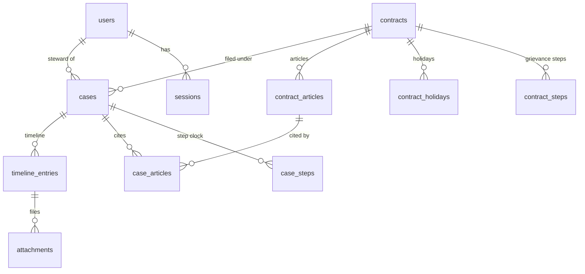

# Architecture

```
src/
├── app.css, app.html, env.ts      Design tokens, HTML shell, typed environment variables
├── hooks.server.ts                DB connection + migrations (init), sessions, auth guard, security headers
├── service-worker/                Precache app shell, network-first pages, cache-first attachments
├── lib/
│   ├── deadlines/                 Pure date math: dates, holidays, work calendar, deadline engine, step chain
│   ├── contracts/                 Rules-based contract reader (articles, steps, holidays) + number parsing
│   ├── client/                    Browser-only: IndexedDB outbox, image downscaling
│   ├── components/                Svelte components (countdown clock, step tracker, timeline, sheets…)
│   ├── server/                    Server-only services (Drizzle/Postgres), auth, PDF text, local LLM client
│   ├── ics.ts, packet.ts          Calendar feed and handoff packet renderers (pure, tested)
│   └── labels.ts, format.ts       Shared labels and formatting
└── routes/                        Pages, form actions and endpoints
drizzle/                           SQL migrations (generated by drizzle-kit, applied on start)
e2e/                               Playwright end-to-end suite
scripts/                           Demo seed, changelog extraction for releases
```

## Principles

- **The date math is pure and isomorphic.** `src/lib/deadlines` has no I/O and runs in the browser (live previews on
  the contract and new-case pages) and on the server with identical results. Dates are `YYYY-MM-DD` strings and all
  arithmetic is UTC-based, so daylight-saving changes and server time zones can't shift a deadline.
- **Due dates are computed, not stored.** A case step stores its trigger date, day count, day type, completion and any
  extension. The due date is derived on every read from the contract's live calendar, so correcting a holiday fixes
  every open case at once.
- **Humans confirm.** Extracted steps start unconfirmed; a contract can only be activated, and cases only opened, when
  every step has been confirmed by a person.
- **Progressive enhancement.** Every mutation is a SvelteKit form action that works without JavaScript; `use:enhance`
  adds in-place updates. The one JSON endpoint is the timeline-entry API used by the offline outbox.
- **The local owns the data.** Attachments live in Postgres (`bytea`), so `pg_dump` is a complete backup, and any case
  exports as JSON.

## Data model



- `cases.search` and `contract_articles.search` are generated `tsvector` columns with GIN indexes for the precedent
  library.
- `timeline_entries.client_id` is unique, which makes offline sync idempotent.
- Case numbers (`2026-014`) are allocated inside a transaction under an advisory lock.

## Request flow

1. `hooks.server.ts` `init` connects to Postgres and applies pending migrations.
2. `handle` sends a fresh install to `/setup`, resolves the session cookie (renewing it when it is close to expiry),
   guards private routes, and adds security headers. CSP is configured in `vite.config.ts`.
3. Pages load data through services in `src/lib/server`, which compute step views with the deadline engine.

## Offline

- The **service worker** precaches the build and static assets, serves navigations and `__data.json` network-first
  with a cache fallback (so recently opened cases work offline), caches attachments on first view, and clears private
  caches on sign-out.
- The **outbox** (`src/lib/client/outbox.svelte.ts`) writes each new timeline entry to IndexedDB before sending it.
  Network failures leave it queued; it retries on `online`, on tab focus and on a timer, because `navigator.onLine` is
  unreliable. Each entry has a client UUID the server deduplicates on.

## Build metadata

`vite.config.ts` injects `__APP_VERSION__`, `__BUILD_NUMBER__`, `__GIT_SHA__` and `__BUILD_DATE__` from
`APP_VERSION`, `BUILD_NUMBER`, `GIT_SHA` and `BUILD_DATE` (set by CI), falling back to `package.json` and git. The same
values name the SvelteKit app version (used for update detection) and appear in the UI, `/healthz` and image labels.
